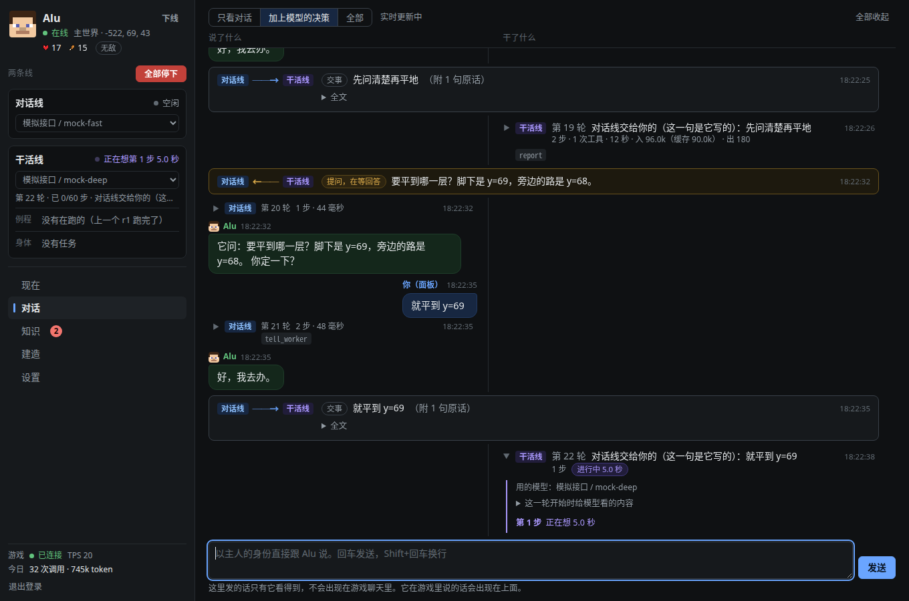
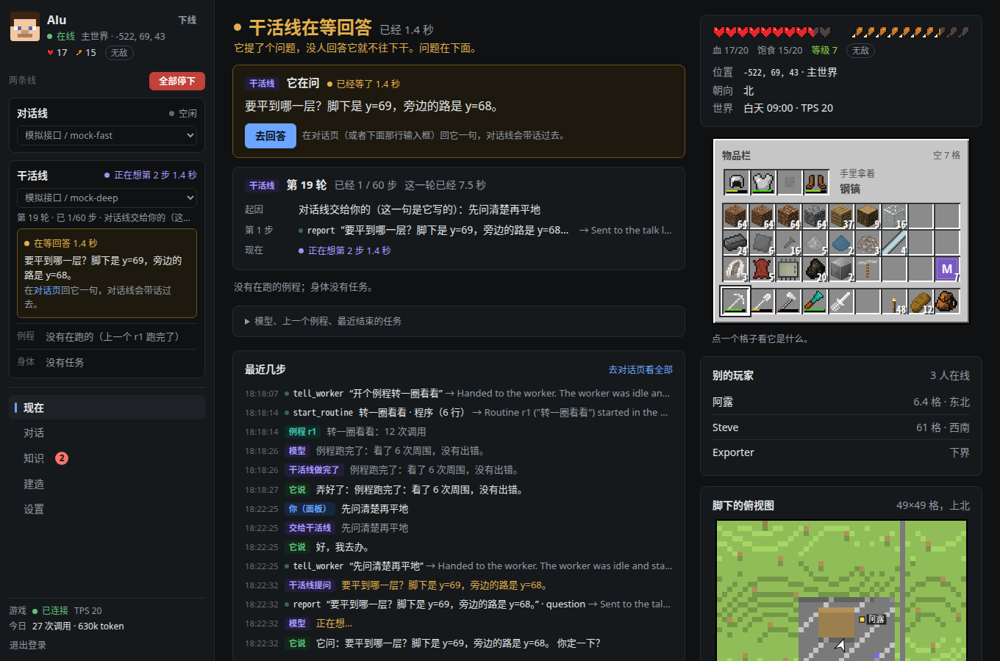

# Alu AI Player

GTNH（GT New Horizons，Minecraft 1.7.10）服务器里的 AI 玩家：一个真的玩家实体，按生存规则走路、挖、放、开箱子、用机器，由大模型决定做什么。主人在不在线它都能接着干。

*An AI player for GT New Horizons (Minecraft 1.7.10) servers: a real player entity that walks, digs, builds from schematics, uses chests, drawers and GregTech machines by survival rules, driven by an LLM. A server-side Forge mod is its body; a separate Node service is its brain, with a web panel. The docs are in Chinese.*

- **身体** `mod/`：只装在服务端的 Forge mod。客户端不用装任何东西。
- **大脑** `brain/`：独立的后台服务。听游戏里的聊天，调大模型，指挥身体；带网页面板，用来配置模型服务和 API key、看它在想什么和做什么。大脑里是“一个玩家，两条线”：**对话线**跟人说话和查资料，**干活线**操纵身体，各用各的模型和上下文，所以它干着活也回得了话（[docs/TALK_WORK.md](docs/TALK_WORK.md)）。
- 两者之间的全部约定在 [docs/PROTOCOL.md](docs/PROTOCOL.md)，整体设计在 [docs/ARCHITECTURE.md](docs/ARCHITECTURE.md)。



## 现状

实验性质。在一台 GTNH 2.9.0 服务器的副本上开发和实测（基地 HV 中期，没有 AE），还没有在正式服长期跑过。做得到什么、哪些没验证，下面和各文档里都照实写着。

需要：

- 一台 GTNH 2.9.0 的服务器（你有权装 mod、能重启）。别的版本没试过。
- 跑大脑的机器：Node 24（TypeScript 由 Node 直接执行，运行时没有任何依赖），和游戏服务器同一台最省事。
- 一个大模型的接口：OpenAI 兼容（Chat Completions）或 Anthropic 兼容（Messages）都行，在面板里填。要能调工具；上下文越大越好（它每一步都带着几万到二十多万 token 的上下文）。
- 一份 GTNH 的客户端整合包：物品、配方、任务书、指南这些资料是从你自己的客户端里导出来的（[docs/PACKDATA.md](docs/PACKDATA.md)），仓库里不带。
- `tools/` 下的开发脚本是给 Linux 写的（测试服和大脑各是一个 systemd 用户服务）。

## 谁做的

代码、测试和文档全部由 Claude（Anthropic 的 AI）编写。想法、方向、每一步“像不像个玩家”的判断和游戏里的实测来自 oyaxira。

## 它现在会做什么

| 类别 | 任务 |
|---|---|
| 走动 | 走到坐标、走到玩家身边、跟随玩家、`/home` 传送、`/sethome`；路上会开门、坐 OpenBlocks 电梯，够不着时垫脚 |
| 地形 | 把一块地整平（挖高填低）、清空一个盒子、挖指定方块 |
| 建造 | 照 Schematica 图纸盖建筑框体（先盘点、再清障、再放方块，材料自己去仓库取）；用一种方块填满盒子、只砌六个面、只砌四面墙、按清单逐块放置 |
| 物品 | 往箱子和抽屉里存、从里面取（数量精确）、在两个容器之间来回搬、捡地上的掉落物、把东西递给玩家；把身上的背包当容器用；把手上的东西右键用一下（吃、穿戴、没见过的物品） |
| 制作 | 查物品、查做法、查用途（和 NEI 一样全的本地配方册，中文）、查某样东西存在基地哪里、手工合成（随身 2×2 或走到合成站）、用 GT 机器加工一批并取回产物（单方块机器，以及多方块机器：原料放输入总线、设编程电路、流体用单元倒进输入仓、从输出总线取） |
| 任务书 | 任务书的章节、任务内容和要求（本地中文资料）、某个玩家的进度（只查，不替人提交或领奖） |
| 感知 | 自己的状态和背包、区域高度图、找方块、附近的箱子抽屉和里面的东西（接没接管道、抽屉管理器管着什么）、附近的机器、附近的实体、世界和图纸的逐格对比、某个玩家站在哪朝哪指着什么、一片区域的方块（画成图给模型看） |
| 自己出设计 | 模型写小程序生成图纸草稿（小屋、像素画），主人在面板上看过三维预览再盖；程序也能调查询和动作，把一长串操作做完 |
| 资料 | 游戏内指南（玩家按 G 看的那本）能搜能读；物品的悬停提示；多方块机器的结构和现场对照；凿子能把什么变成什么 |
| 记性 | 主人教的事记成笔记和手册；历史太长时写成一份交接记录接着干，压掉的细节能翻自己的活动日志找回来 |
| 说话和干活分开 | 它在干活（一轮几十秒到几分钟）的时候照样听得到、回得了话：回话的那条线不等干活的那条线；问它“在干嘛”它答得出；说“停”一次生效（任务、例程、正在想的那一步都停）；交代的事连同你的原话和你指着的方块原样到干活的那条线 |

任务下达后由身体自己做完，期间不调用模型；任务队列存在世界存档里，服务器重启后接着做。



## 目录

```
mod/         服务端 mod（GTNH 官方模板，Java）
brain/       大脑服务（TypeScript，Node 24，无运行时依赖）
docs/        架构、协议、部署、资料格式
tools/       开发脚本
testserver/  完整 GTNH 测试实例（不入库，由 tools/testserver setup 生成）
```

## 开发

```bash
tools/gradle build                 # 编译 mod，产物在 mod/build/libs/
tools/testserver setup             # 从你的服务器实例只读复制出一个测试实例（独立端口、全新世界）；实例在哪写在 tools/local.env
tools/testserver install           # 把刚编译的 mod 放进测试实例
tools/testserver start             # 约 40 秒
tools/test-kit.sh Alu              # 给测试用的 bot 一套匠魂工具和一组泥土
tools/bridge.py call bot.spawn '{"name":"Alu"}'
tools/bridge.py call task.start '{"bot":"Alu","task":{"type":"goto","x":-44,"z":-80}}'
tools/bridge.py listen             # 看事件
tools/testserver rcon list
tools/testserver stop
tools/brain deploy                 # 让连着测试服的大脑跑仓库里当前这个提交；之后 start / stop / status / log

tools/client setup                 # 我们自己的一份游戏客户端（不走启动器），只用来导出资料
tools/export-packdata              # 从客户端里的 NEI 导出物品表、配方册、方块颜色，约 10 分钟
tools/make-packdata.py quests …    # 从客户端包里取任务书（中文）和方块贴图
```

测试服和连着它的大脑各是一个 systemd 用户服务（`aiplayer-testserver`、`aiplayer-brain-test`，由上面两个脚本临时建立，不随开机启动），不挂在启动它们的那个终端或程序下面，那边退出、重启都不影响它们。大脑跑的是 `.run/brain/` 里某个提交的一份副本，不是工作区里正在改的源码：改完、提交之后 `tools/brain deploy` 才换上新版本；`tools/brain status` 会写明现在跑的是哪个提交、仓库里有没有更新的。

物品、配方、任务书这些不会变的资料放在大脑这边（`brain/packdata/`，见 [docs/PACKDATA.md](docs/PACKDATA.md)），每个整合包版本生成一次；身体只回答实时的事。

测试实例端口：游戏 10186，RCON 25576，bridge 25591。它只读取正式实例的文件，从不写入。

本机的两个路径写在 `tools/local.env`（不入库）：

```bash
AIPLAYER_SOURCE_INSTANCE=/path/to/your/server/instance      # tools/testserver setup 从这里复制
AIPLAYER_CLIENT_PACK=/path/to/GTNH-2.9.0-client.zip          # tools/client setup 用的客户端整合包
```

大脑的开发和运行见 [brain/README.md](brain/README.md)。

## 部署到正式服

见 [docs/DEPLOY.md](docs/DEPLOY.md)。装身体（mod）需要重启一次游戏服务器；大脑用 `tools/live deploy` 一条命令发布，随时可以更新和回滚，不用停游戏。

## 在 GTNH 里要知道的几件事

- **工具**：GTNH 里原版镐铲和 GregTech 的镐铲都挖不动东西，要给它匠魂（Tinkers' Construct）工具，和玩家一样。扔在它脚边它会捡，或者放进箱子让它取。
- **领地**：它在 ServerUtilities 眼里是普通玩家。要在已认领的区块里动手，队伍主人执行 `/team status <名字> ally` 把它设成盟友即可（队伍默认允许盟友挖、放、开箱子）；想让它成为正式成员则执行 `/team status <名字> invited`，再让它执行 `team join <队伍>`。
- **白名单**：服务器开着白名单时，mod 会在它第一次上线时把它加进白名单，否则其他 mod 不承认它。
- **皮肤**：`skin <名字> set <正版用户名>`（服务器已有的 PierceSkinRestorer）。想让每个新建的 bot 都自动用同一个皮肤，在 mod 配置里写 `"newBotCommands": ["skin {name} set 正版用户名"]`。
- **图纸**：把 `.schematic` 放进服务器的 `config/aiplayer/schematics/`（或在面板里上传），或者让它自己设计。带内容或朝向的方块（箱子、抽屉、楼梯、机器、管道）它现在还不放，会列出来留给人。
- **玩家名**：不开正版验证的服务器上名字可以是中文，它都认。
- **名字**：物品、配方、任务书在大脑里都是游戏里的中文名（从客户端导出的）；身体自己报的名字是英文，大脑按物品 id 换成中文。
- **机器**：GregTech 的单方块机器和多方块机器（输入输出总线、往输入仓倒流体单元）都会用，产物是流体的配方也认；机器上的覆盖板（槽位扩展里的模具）、流体罐、界面上的开关和页签（新式界面）它看得到也点得了；长时间的加工可以放进去就走，回头再收。别的 mod 带界面的方块当普通机器用：放进去、等、取。被漏斗或管道接着的总线它会当成主人的自动化，先问再动。还没验证的：蒸汽多方块的实际加工、拿单元对着流体格装倒、用全息投影仪搭多方块。
- **指着说**：对它说“这个箱子”“我面前的”时，它知道你站在哪、朝哪、准星指着什么。
- **进不去的地方**：铁门这类只能用红石开的门它打不开。
- **默认无敌、不掉饱食度**。可以在面板里关掉；关掉后它会受伤、会死、会按服务器规则掉落物品并自动重生。
- **睡觉**：这台服务器按在线人数的一半算跳过夜晚，它算一个在线的人。正好两个真人在线时，会从“一人睡即可”变成“两人都要睡”。
- **紧急停止**：管理员在游戏里执行 `/aiplayer stop <名字>` 取消它的全部任务，`/aiplayer despawn <名字>` 让它下线。

## 许可

MIT，见 [LICENSE](LICENSE)。`mod/` 的构建脚手架来自 GTNH 的 mod 模板（MIT），仓库里不含 GTNH 整合包的任何内容，见 [NOTICE](NOTICE)。
